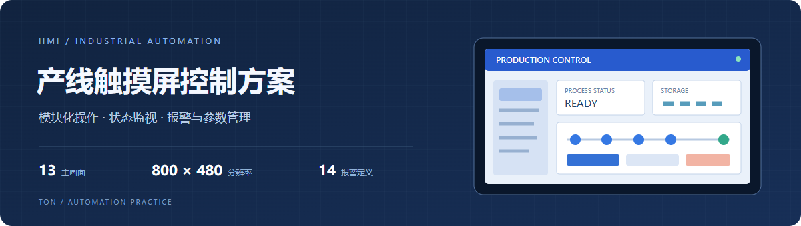

<div align="center">



**模块化操作 · 自动运行 · 报警记录 · 参数设置 · 库位管理**

[在线浏览 13 个画面](https://ton242678-glitch.github.io/industrial-hmi-panel/) · [下载触摸屏工程](engineering/industrial-panel-demo.xjp) · [工程与打开方法](docs/engineering.md)


</div>

## 项目简介

面向模块化产线的触摸屏控制方案，覆盖输送、搬运、灌装、旋盖称重与库位管理。通过独立操作画面、公共导航、报警和参数页面，把设备控制入口与运行信息组织在 800 × 480 的触摸屏中。

**个人负责内容：触摸屏界面和手动控制相关工作。** 原工程已完成 TouchWin 编译与硬件验证。本仓库提供工程公开副本、可浏览的画面预览、功能说明和归档检查工具。

| 工程信息 | 内容 |
| --- | --- |
| 触摸屏型号 | TS5-700-E/W/4G |
| 画面分辨率 | 800 × 480 |
| 主要操作画面 | 13 页，另保留工程内系统页面 |
| 报警定义 | 14 条 |
| 工程格式 | `.xjp`，使用 TouchWin Pro 打开 |
| 展示方式 | GitHub 图文说明 + 浏览器画面展厅 + 可下载工程 |

## 界面预览

| 自动运行 | 输送手动操作 |
| --- | --- |
|  |  |
| 库位与过程状态、启动、暂停、继续、急停和复位入口 | 正反转点动、持续运动、气缸操作与停机入口 |

预览依据工程中的控件、文字、坐标和内嵌图片生成，部分控件样式简化，动态数据以“—”表示。完整画面与交互行为以 TouchWin 工程为准。[查看全部画面](docs/screens.md)。

## 方案构成

| 功能区域 | 主要内容 | 对应画面 |
| --- | --- | --- |
| 登录与导航 | 角色选择、登录入口、模块目录和公共导航 | 01、02 |
| 手动操作 | 输送正反转、轴点动和寸动、灌装及旋盖气缸控制 | 03、04、06、07 |
| 库位管理 | 六个库位的状态查看与信息更新入口 | 05 |
| 自动运行 | 手自动切换、启动、暂停继续、库位与过程数据显示 | 08 |
| 报警记录 | 报警信息、触发时间、确认和恢复等记录字段 | 09 |
| 参数与 I/O | 输入输出点位说明、机械参数、运动参数 | 10–13 |

## 怎样查看

- **快速了解方案：** 打开[在线画面展厅](https://ton242678-glitch.github.io/industrial-hmi-panel/)，从左侧切换 13 个画面，或查看单页大图。
- **查看原生工程：** 下载或克隆仓库，用 TouchWin Pro 打开 [`engineering/industrial-panel-demo.xjp`](engineering/industrial-panel-demo.xjp)。
- **检查归档：** 安装 Python 3.10 或更高版本，在仓库根目录运行 `python tools/inspect_hmi.py`。无需第三方 Python 依赖。
- **本地打开网页：** 直接打开 `index.html`，或运行 `python -m http.server 4176`，访问 `http://127.0.0.1:4176`。

公开演示副本中的预置登录口令统一为 `000000`；原口令、本机绝对路径和编辑器锁文件已处理。连接设备前请重新配置通信与账号设置，具体见[工程说明](docs/engineering.md)。

## 项目完成与归档记录

| 项目 | 状态 |
| --- | --- |
| 原工程 TouchWin 编译 | 已完成，作者在项目实践中完成并确认 |
| 原工程硬件验证 | 已完成，作者在项目实践中完成并确认 |
| 公开副本结构检查 | 13 个主要画面、14 条报警定义及内嵌资源保留 |
| 画面展厅检查 | 13 页切换与图片加载、桌面和移动端排版检查 |
| 自动归档检查 | 检查文件完整性、画面数量及公开副本中的口令和路径 |

本次整理处理了公开副本的口令、路径、工程标题和锁文件，保留控件地址与动作定义；编译和硬件验证属于原工程实践记录。检查细节与 SHA-256 见[归档验证](docs/validation.md)。

## 仓库结构

```text
engineering/industrial-panel-demo.xjp  触摸屏工程公开副本
docs/images/                         页头与 13 个画面预览
docs/screens.md                      画面索引
docs/engineering.md                  工程打开与配置说明
docs/project-summary.json            工程摘要与文件指纹
assets/                              静态画面展厅
tools/                               归档检查和网站打包
```

工程及内嵌素材的来源和许可范围见 [NOTICE.md](NOTICE.md)。新增网页和工具与原工程的许可分别说明。
