# 画面索引

以下为工程定义的静态预览，控件布局、文字和内嵌图片来自公开工程。画面样式部分简化，运行时数值与状态未做模拟。

[打开在线画面展厅](https://ton242678-glitch.github.io/industrial-hmi-panel/)

| 画面 | 功能 | 单页预览 |
| --- | --- | --- |
| 01 登录界面 | 角色选择、登录与访问入口 | [查看大图](images/page-01.png) |
| 02 目录 | 操作模块和公共页面导航 | [查看大图](images/page-02.png) |
| 03 输送模组 | 输送正反转、气缸、急停与复位 | [查看大图](images/page-03.png) |
| 04 搬运模组 | 多轴点动、寸动和搬运气缸控制 | [查看大图](images/page-04.png) |
| 05 库位信息 | 六个库位的状态查看与刷新 | [查看大图](images/page-05.png) |
| 06 灌装模组 | 灌装电机与气缸动作入口 | [查看大图](images/page-06.png) |
| 07 旋盖称重模组 | 旋盖、夹紧、称重和点动入口 | [查看大图](images/page-07.png) |
| 08 自动界面 | 自动启停、暂停继续、库位和过程状态 | [查看大图](images/page-08.png) |
| 09 报警界面 | 报警信息、确认与恢复记录 | [查看大图](images/page-09.png) |
| 10 IO分配 | 第一组输入输出点位说明 | [查看大图](images/page-10.png) |
| 11 机械参数 | 每转脉冲数、移动量与行程设置 | [查看大图](images/page-11.png) |
| 12 运动参数 | 点动速度、寸动速度与距离设置 | [查看大图](images/page-12.png) |
| 13 IO分配2 | 第二组输入输出点位说明 | [查看大图](images/page-13.png) |

## 01 登录界面

角色选择、登录与访问入口

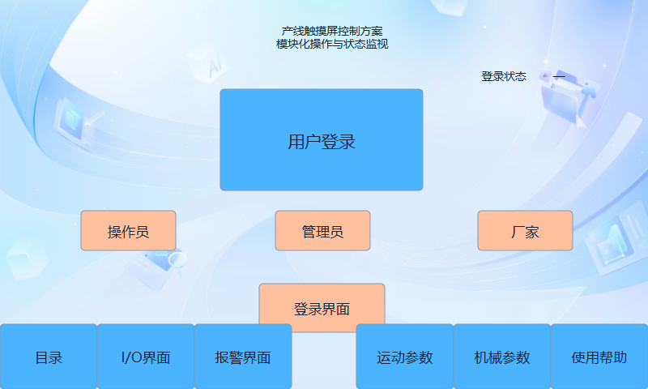

## 02 目录

操作模块和公共页面导航

## 03 输送模组

输送正反转、气缸、急停与复位

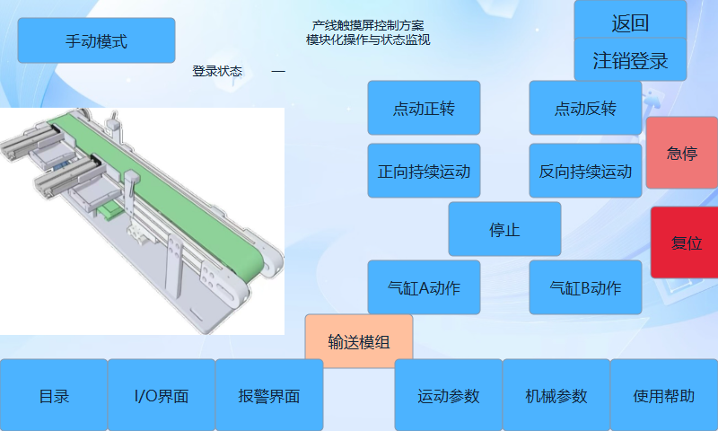

## 04 搬运模组

多轴点动、寸动和搬运气缸控制

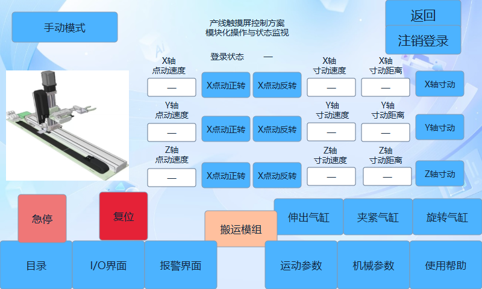

## 05 库位信息

六个库位的状态查看与刷新

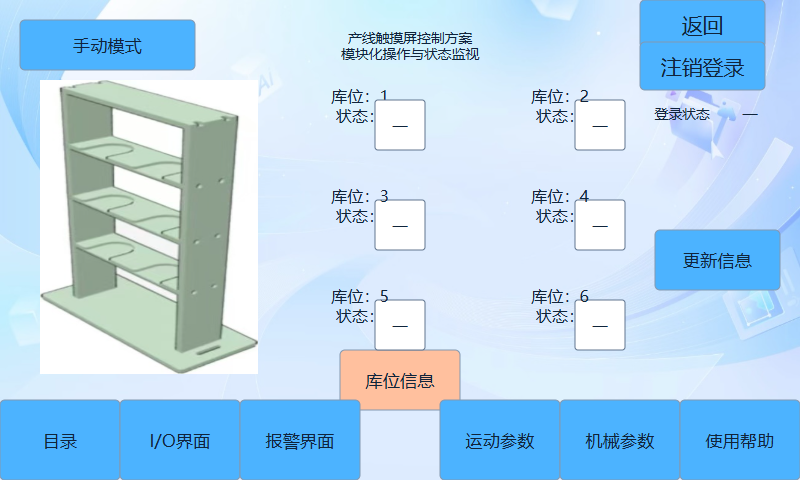

## 06 灌装模组

灌装电机与气缸动作入口

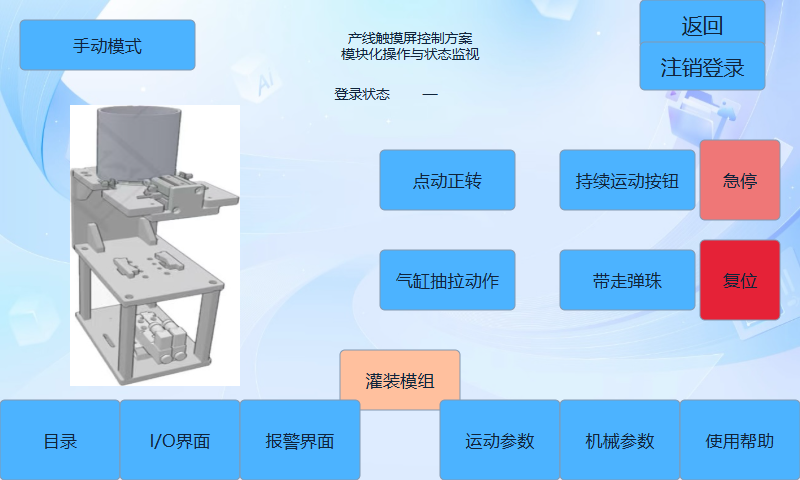

## 07 旋盖称重模组

旋盖、夹紧、称重和点动入口

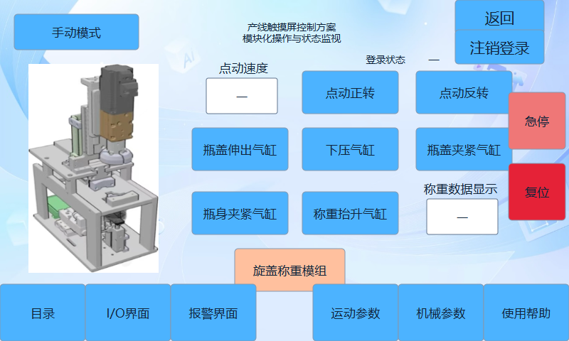

## 08 自动界面

自动启停、暂停继续、库位和过程状态

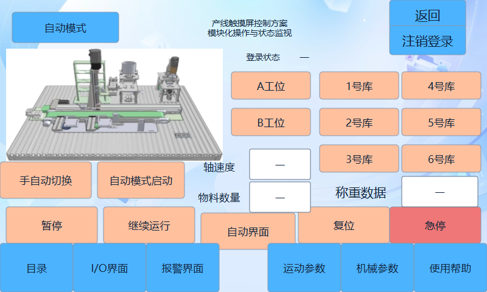

## 09 报警界面

报警信息、确认与恢复记录

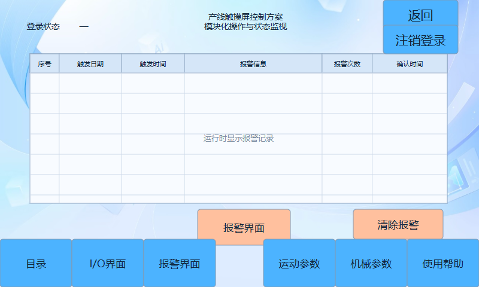

## 10 IO分配

第一组输入输出点位说明

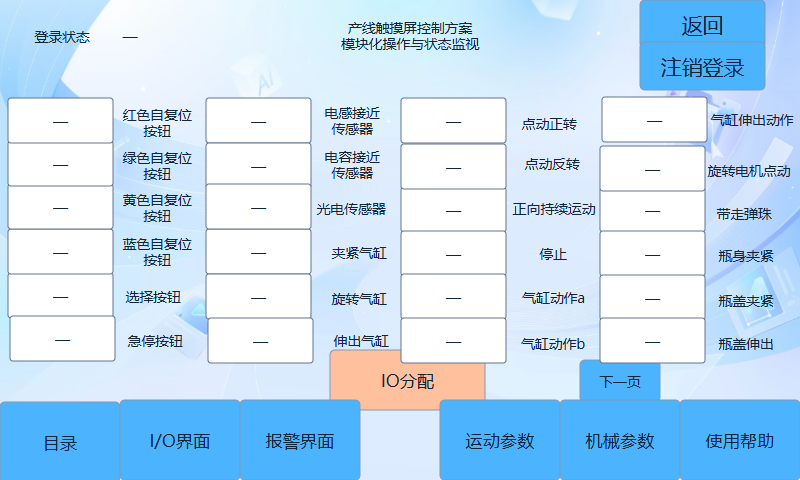

## 11 机械参数

每转脉冲数、移动量与行程设置

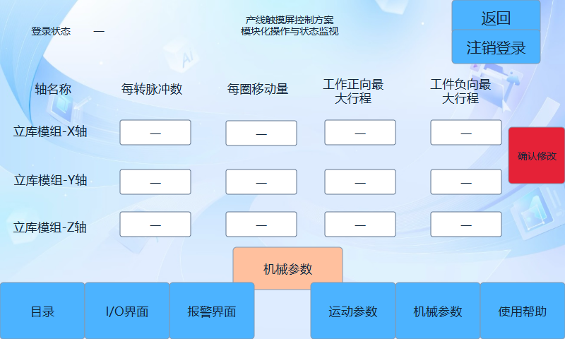

## 12 运动参数

点动速度、寸动速度与距离设置

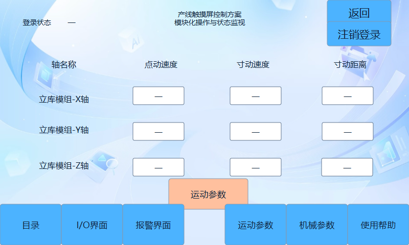

## 13 IO分配2

第二组输入输出点位说明

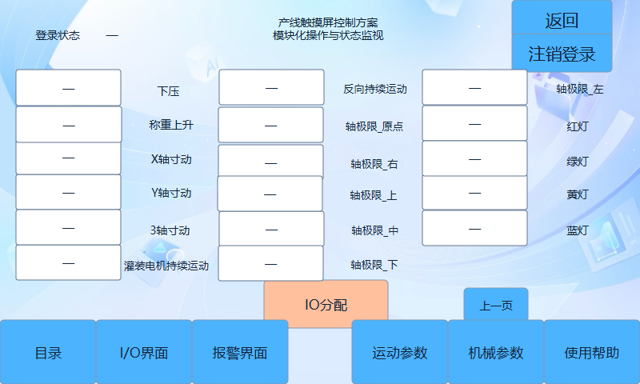
